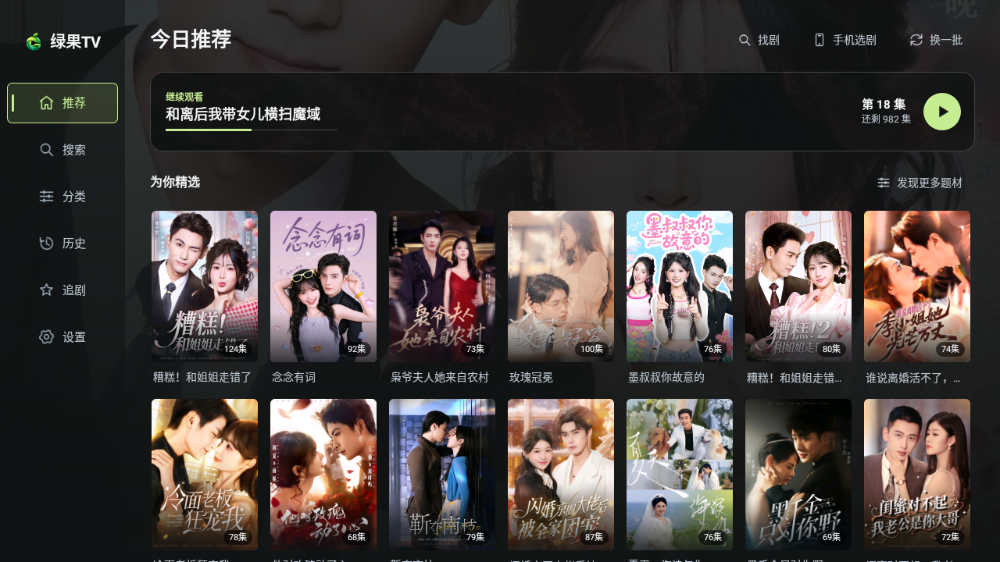
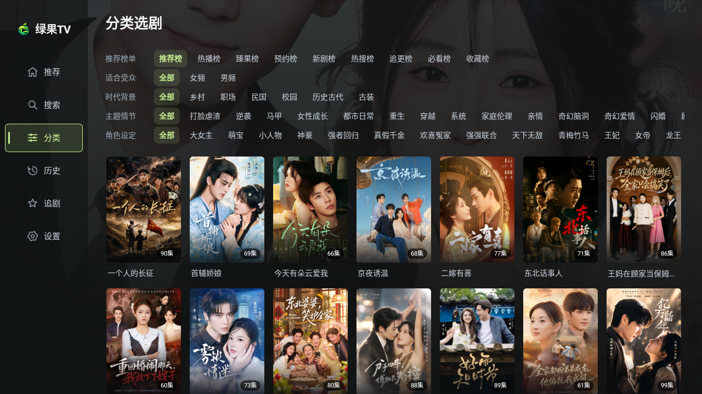
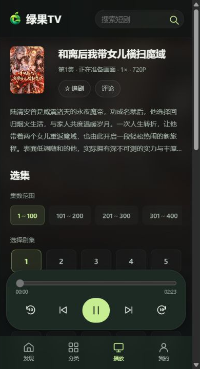
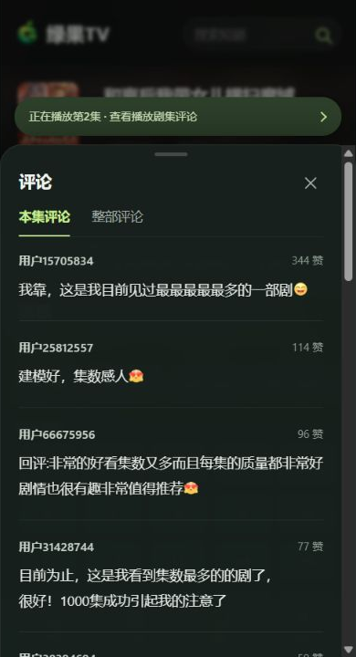

# 绿果TV（红果短剧电视端客户端）

**用遥控器看剧，用手机选剧。**

红果短剧第三方 Android TV / 投影仪客户端。使用遥控器播放，手机通过局域网页面选剧与控制。

[下载安装包](https://github.com/Amor5207/lvguo-tv/releases/latest) · [界面预览](#界面预览) · [使用方式](#使用方式) · [构建项目](#构建项目)

## 亮点

- **遥控器友好**：原生 Android 界面，支持方向键导航、长按快进快退、双击上下切集。
- **手机选剧，电视播放**：扫码或输入链接即可连接，无需安装手机应用，支持多台手机同时控制。
- **两端协同**：搜索、分类筛选、选季选集、追剧、评论，以及播放、进度、倍速和画质控制。
- **本地片单**：继续观看、断点续播、200 条观看历史、300 条追剧记录与已看完追剧清理。
- **长剧集管理**：隐藏不可播放的季，按每 100 集分组，播放跨组时自动同步选中范围。
- **播放兼容**：按设备能力筛选画质，播放失败时尝试兼容路径并回退至 720P，支持导出播放诊断。

## 界面预览

TV 截图来自 Android 9 模拟器，手机截图来自配套网页。

### TV 推荐与分类





### 手机遥控

| 播放与选集 | 评论 |
| --- | --- |
|  |  |

## 下载与使用

从 [GitHub Releases](https://github.com/Amor5207/lvguo-tv/releases) 下载 `hongguo-tv.apk`，安装到电视或投影仪。

- **系统要求**：Android 6.0（API 23）及以上。
- **作者尝试设备**：京东京造北极星 Lite 投影仪，Android 9。
- **其他设备**：请自行测试，不提供兼容性适配。画质取决于实际解码能力，未包含额外软解库。

### 使用方式

1. 在电视打开应用，阅读并同意首次使用须知，即可选剧播放。
2. 手机与电视连接同一局域网，在电视上打开“手机选剧”。
3. 手机扫码，或在浏览器地址栏输入电视显示的完整链接（含 `http://` 和 `:8765`）。
4. 在手机网页选剧、查看评论或控制电视；视频仍在电视播放。

电视应用需保持运行。连接失败时检查网络、IP、端口和路由器设备隔离设置。控制服务仅用于可信局域网，请勿将 `8765` 端口暴露到公网。

### 常用操作

| 操作 | 方式 |
| --- | --- |
| 移动焦点 / 执行操作 | 方向键 / 确认键 |
| 呼出播放控制 | 确认键，默认聚焦中央播放 / 暂停 |
| 快退 / 快进 | 中央控制聚焦时按左右键，支持长按 |
| 上一集 / 下一集 | 控制隐藏时快速双击上 / 下键 |
| 播放时返回 | 控制隐藏时先显示控制，再按返回退出 |
| 删除历史 / 取消追剧 | 聚焦卡片后长按确认键 |

播放异常时可先使用 720P，通过手机“我的 → 播放诊断”保存设备与解码信息。

## 技术实现

| 模块 | 实现 |
| --- | --- |
| TV 界面 | Java + Android 原生 View，自定义焦点导航与遥控器交互 |
| 播放 | Android MediaPlayer + Media3 ExoPlayer，解码能力检测与实际播放验证 |
| 媒体加载 | 流式读取、MP4 数据与时间戳处理、媒体缓存和后续剧集预加载 |
| 手机网页 | APK 内嵌 HTML / CSS / JavaScript，无需前端构建或独立部署 |
| 两端通信 | Android 前台服务内置 HTTP 服务，提供内容查询、状态同步和播放控制 |
| 图片 | 内存 / 磁盘 LRU 缓存、降采样、并发请求合并 |
| 本地数据 | 本地文件与 SharedPreferences 保存片单、偏好及诊断事件 |
| 二维码 | ZXing Core |

主要代码位于 `src/com/hgtv/app/`，手机网页位于 `res/raw/companion.html`。内容查询集中在 `net/`，播放在 `media/`，局域网服务在 `remote/`，TV 界面在 `ui/`。

## 构建项目

使用 JDK 17、Android SDK Platform 35，以及与 Android Gradle Plugin 8.5.2 匹配的 Gradle 环境。

用 Android Studio 打开根目录，同步依赖后选择 **Build APK(s)**；或在已安装 Gradle 的环境执行：

```shell
gradle assembleDebug
```

调试产物位于 `build/outputs/apk/debug/`。

独立 SDK 构建可使用 `build_local.py`，通过 `JAVA_HOME`、`ANDROID_SDK_ROOT`、`HGTV_KEYSTORE` 配置工具链和签名。

## 维护范围

**作者按个人使用需求维护项目，主要修复影响本人使用的 BUG。**

不受理其他设备的 BUG、解码与兼容性问题，不接受样式、布局类优化建议，也不承诺响应或持续维护。有其他需求，请自行 Fork、Vibe Coding。

## 使用声明

本项目由作者出于个人学习与研究目的开发。使用者应遵守适用法律法规，并尊重第三方服务、作品及相关权利。

内容与播放源依赖第三方服务，接口变化可能导致功能不可用。项目不提供自有内容服务，不分发视频文件；截图中的海报、剧名与评论归各自权利人所有，源码公开不代表获得第三方内容授权。

第三方组件及许可证见 [THIRD_PARTY_NOTICES.md](THIRD_PARTY_NOTICES.md) 和 [third_party/](third_party/)。

## 开源协议

本项目源代码采用 [GNU General Public License v3.0](LICENSE)。第三方组件依其各自许可证提供，详见 [THIRD_PARTY_NOTICES.md](THIRD_PARTY_NOTICES.md)。
