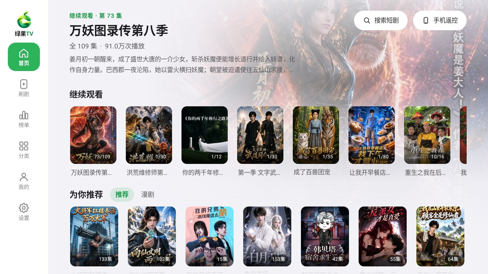
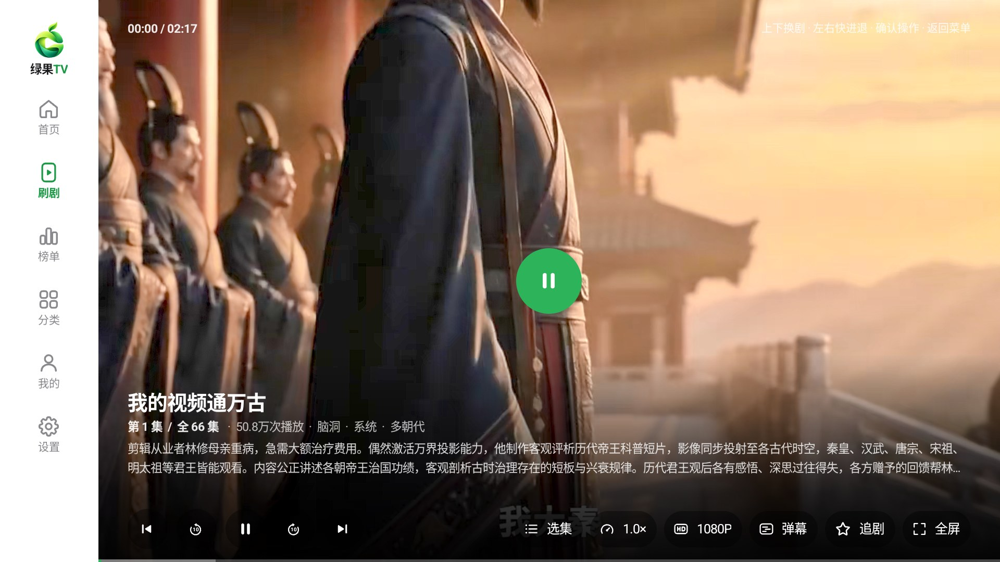
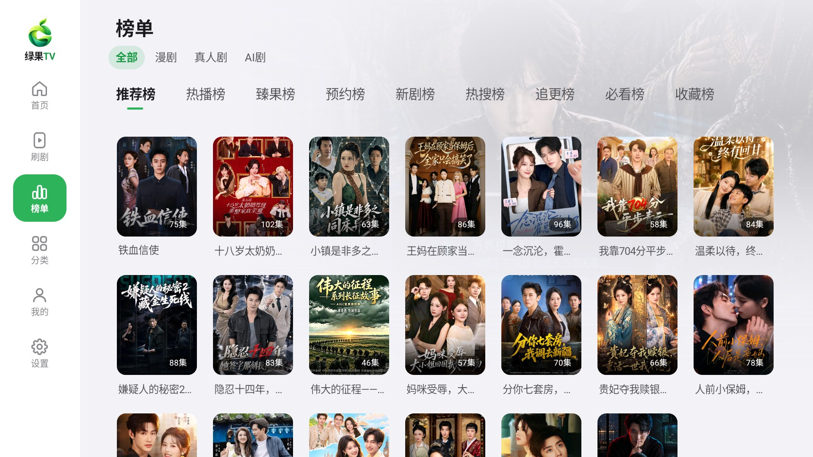
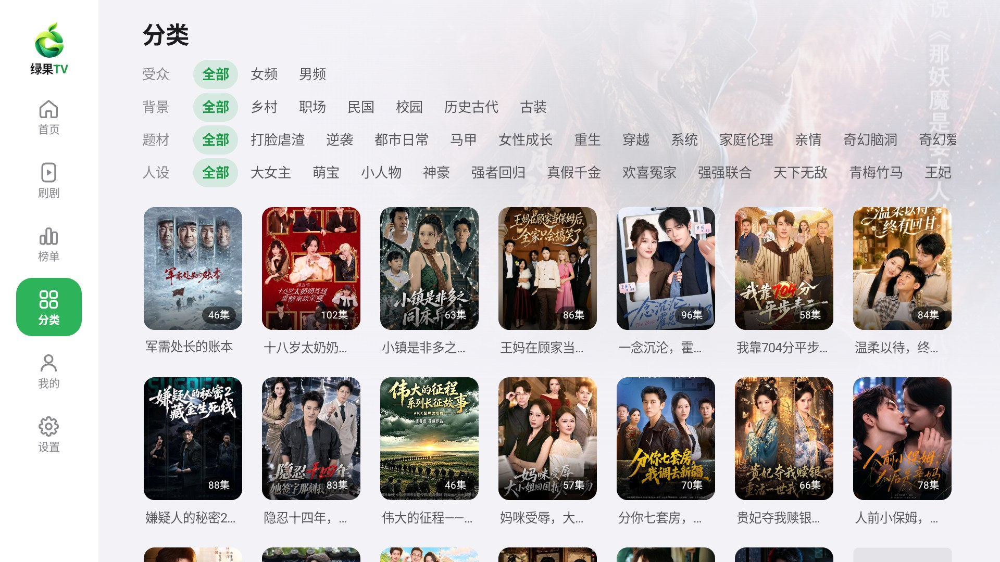
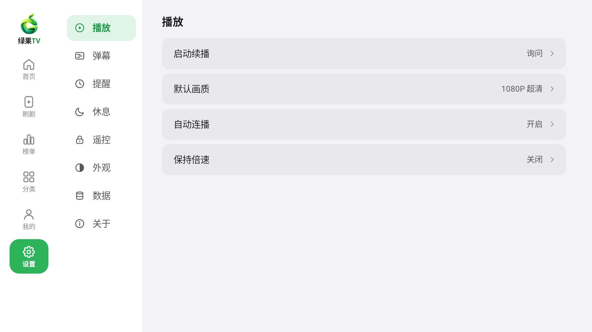
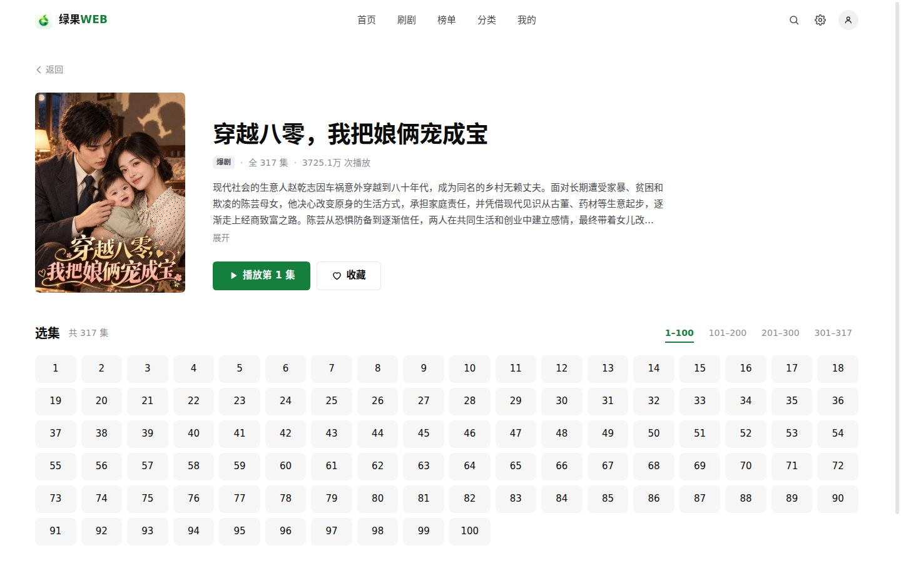
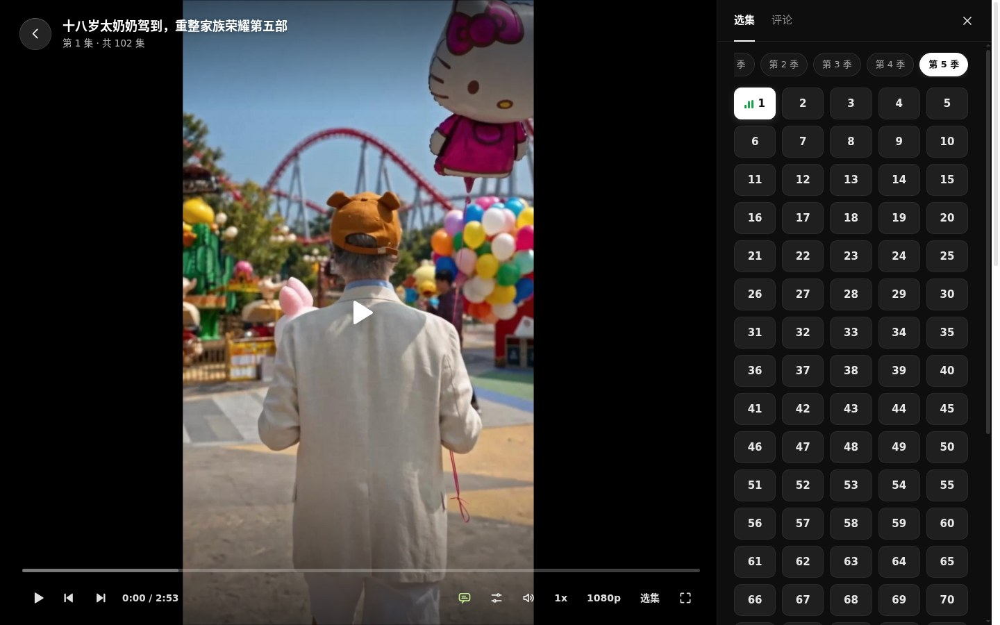
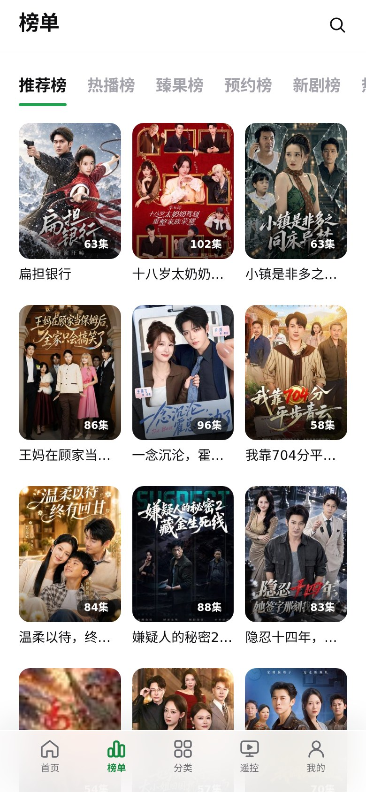
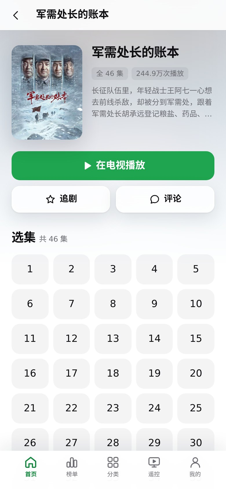
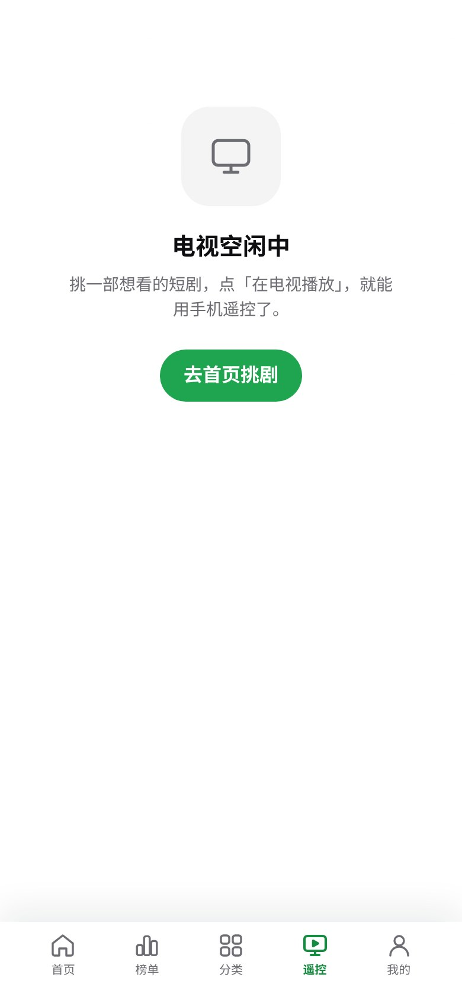

<div align="center">


# 绿果TV

**用遥控器大屏看剧，用手机浏览器随手选剧，用桌面网页端沉浸追剧。**

红果短剧第三方 **Android 电视 / 投影仪客户端**、**PC 桌面客户端** 与 **桌面网页版**

[](https://github.com/Amor5207/lvguo-tv/releases/latest)
[](#系统要求与安装)
[%20%7C%20macOS%20%7C%20Linux-0a84ff?style=flat-square)](#系统要求与安装)
[](https://github.com/Amor5207/lvguo-tv/releases/latest)
[](LICENSE)

[官网体验](https://lvguo.pengfei.ink) · [下载 2.1.0](https://github.com/Amor5207/lvguo-tv/releases/latest) · [界面预览](#界面预览) · [功能特性](#功能特性) · [构建项目](#构建项目) · [致谢](#致谢)

<br>



</div>

## 简介

**绿果TV 2.1** 是面向智能电视、投影仪、桌面端与浏览器的红果短剧第三方客户端：

- **官网快速体验**：[https://lvguo.pengfei.ink](https://lvguo.pengfei.ink)（在线网页端仅用于快速体验，受公共资源与网络波动影响可能不够稳定；如体验符合预期，推荐下载下方 **Android TV 端** 或 **PC 桌面端** 长期稳定使用）
- **Android 电视 / 投影仪端**：面向 1920×1080 大屏设计的原生 Android 应用，纯 Java 实现，单个安装包通用 **32 位 / 64 位 ARM 与 x86** 架构，内置 Media3 硬件解码与局域网手机遥控服务。
- **PC 桌面客户端（绿果PC）**：基于 **Flutter + Rust (`lvguo_core`) + libmpv** 的本地独立桌面端，内置本地解析、CENC 流式解密、多线程离线下载、GPU 着色器超分增强与热更新能力。受限于本地开发与测试环境，目前**主要维护 Windows 版本**；macOS 与 Linux 安装包由 GitHub Actions 自动构建提供，暂不在日常维护与测试范围内。
- **桌面网页端**：基于 Go 标准库与原生前端构建的单二进制 Web 服务，提供 **x86_64（64 位）、x86（32 位）、ARM64（64 位）、ARMv7（32 位）** 构建产物，无需前端打包工具即可独立部署。

---

## 网页端体验邀请码

在线网页端 [https://lvguo.pengfei.ink](https://lvguo.pengfei.ink) 开放以下 **3 个公开体验邀请码**：

| 邀请码 | 使用说明 |
| --- | --- |
| `VYQ8-TU7F` | 先到先得 / 拿到即可访问，记录仅保存于浏览器本地，**不支持绑定红果账号** |
| `6ST8-ZAYQ` | 先到先得 / 拿到即可访问，记录仅保存于浏览器本地，**不支持绑定红果账号** |
| `53R6-ZE6J` | 先到先得 / 拿到即可访问，记录仅保存于浏览器本地，**不支持绑定红果账号** |

服务端支持对单个邀请码开启**同时在线人数上限**保护，管理员可在后台动态管理。自行通过 Releases 或源码部署时默认关闭邀请门禁。

---

## 界面预览

### 电视端（1920×1080）

<table>
  <tr>
    <td width="50%"></td>
    <td width="50%"></td>
  </tr>
  <tr>
    <td align="center"><sub>首页推荐与继续观看</sub></td>
    <td align="center"><sub>沉浸式刷剧播放器</sub></td>
  </tr>
  <tr>
    <td width="50%"></td>
    <td width="50%"></td>
  </tr>
  <tr>
    <td align="center"><sub>多维度榜单</sub></td>
    <td align="center"><sub>分类筛选</sub></td>
  </tr>
</table>

<p align="center">
  <br>
  <sub>设置与观看管理</sub>
</p>

### 桌面网页端

<table>
  <tr>
    <td width="50%"></td>
    <td width="50%"></td>
  </tr>
  <tr>
    <td align="center"><sub>桌面端首页</sub></td>
    <td align="center"><sub>桌面端榜单</sub></td>
  </tr>
  <tr>
    <td width="50%"></td>
    <td width="50%"></td>
  </tr>
  <tr>
    <td align="center"><sub>分类筛选</sub></td>
    <td align="center"><sub>剧集详情与分段选集</sub></td>
  </tr>
</table>

<p align="center">
  <br>
  <sub>影院式播放器（选季 / 选集 / 评论 / 弹幕）</sub>
</p>

### 手机遥控（免安装扫码即用）

<table>
  <tr>
    <td width="20%"></td>
    <td width="20%"></td>
    <td width="20%"></td>
    <td width="20%"></td>
    <td width="20%"></td>
  </tr>
  <tr>
    <td align="center"><sub>首页</sub></td>
    <td align="center"><sub>榜单</sub></td>
    <td align="center"><sub>分类</sub></td>
    <td align="center"><sub>详情与选集</sub></td>
    <td align="center"><sub>遥控面板</sub></td>
  </tr>
</table>

---

## 功能特性

### Android 电视 / 投影仪端

- **大屏与遥控器原生交互**：基于 1920×1080 设计，提供完整方向键焦点导航、数字键选集直达、长按快进快退以及长按确认键快速管理历史/收藏。
- **内容浏览与频道发现**：包含推荐流、短剧/漫剧频道、热播/新剧/热搜/追更/必看等分类榜单、多维度标签筛选、搜索及新剧预约上线提醒。
- **沉浸式刷剧与大屏播放**：支持主界面侧栏直达刷剧流，上下键快速切换剧集，左右键调节进度；采用 Media3 ExoPlayer 进行 H.265 硬件解码（最高支持 1080P），支持多倍速、选季选集、整季播完自动连播下一季与双路预载。
- **真实评论弹幕**：弹幕数据来自剧集真实评论，可自由调整开关、滚动速度、字号与不透明度。
- **免安装手机遥控**：电视端内置局域网服务（默认端口 `8765`），手机浏览器扫码即可选剧、搜索、查看评论并实时控制播放进度、倍速与清晰度，支持访问密码保护。
- **观看健康管理**：支持连续观看提醒、定时暂停、整点报时与休息时段管控。
- **账号登录与实时同步**：需使用红果 App 扫码或手机号验证码登录使用，收藏、历史与播放进度与手机红果 App 实时同步；退出或会话失效时自动回到登录页。
- **应用内更新与动态播放模块**：支持检查应用更新，并支持对已签名的播放签名模块进行安全更新。

### PC 桌面客户端（绿果PC，主维护 Windows）

- **本地独立内核**：Rust 独立完成请求签名、剧集解析与 CENC 本地流式解密，无需外部后端服务，全部策略与算法模块支持热更新与一键回滚。
- **独立多窗播放器与画质增强**：基于 libmpv 硬件解码，支持主窗浏览与独立播放窗口解耦、实时评论弹幕、多倍速/选季选集，以及 **CAS 锐化** 与 **双 Pass FSR 边缘重建超分** GPU 着色器增强。
- **多线程离线下载**：支持剧集批量缓存、Range 分片并发下载、断点续传、限速控制与离线弹幕缓存。
- **应用内更新**：支持版本检测、安装包下载与安装引导，并支持播放模块安全更新。

### 桌面网页端（快速体验版）

- **桌面影院式交互**：悬浮导航栏与卡片流布局，支持浅色 / 深色 / 跟随系统主题、骨架屏占位、图片懒加载与悬停预取。
- **桌面播放器**：居中影院视图，右侧停靠选集与评论面板，支持弹幕、倍速、清晰度切换、自动连播以及键盘快捷键（空格、`←`/`→`、`↑`/`↓`、`N`/`P`/`F`/`M`/`D`/`T`）。
- **CENC 服务端流式解密**：服务端完成请求签名与 CENC 媒体流解密后直出给浏览器硬件解码，不落盘、不分发任何视频文件，多浏览器会话相互隔离。
- **访问控制与在线名额管理**：支持按浏览器隔离的本地仅浏览体验码与同时在线人数限制。

---

## 版本信息

| 项目 | 数值 |
| --- | --- |
| 当前版本 | `2.1.0` |
| 内部版本号 | `2100` |
| Android 包名 | `ink.pengfei.lvguo` |
| 官网（快速体验） | [https://lvguo.pengfei.ink](https://lvguo.pengfei.ink) |

---

## 系统要求与安装

### Android TV / 投影仪端

| 项目 | 要求 |
| --- | --- |
| 系统版本 | Android 6.0（API 23）及以上 |
| 适用设备 | 智能电视、投影仪、Android TV 盒子 |
| 解码能力 | 需设备支持 H.265（HEVC）硬件解码 |
| 架构兼容 | 纯 Java 实现，32 位 / 64 位 ARM 与 x86 通用 |

1. 从 [Releases](https://github.com/Amor5207/lvguo-tv/releases/latest) 下载 `LvguoTV-2.1.0.apk`。
2. 安装到电视或投影仪后，通过红果 App 扫码或手机号验证码登录即可开始浏览与播放。
3. 使用手机遥控时需确保手机与电视处于同一局域网（仅建议在可信局域网内使用）。

### PC 桌面客户端（绿果PC）

> **维护范围说明**：受限于本地开发与测试环境，PC 端**主要维护 Windows 版本**；macOS 与 Linux 构建产物由自动化流程构建提供，暂不在日常维护与实机测试范围内。

- 从 [Releases](https://github.com/Amor5207/lvguo-tv/releases/latest) 下载对应平台安装包（Windows 推荐 `LvguoPC-Setup-2.1.0-win-x64.exe`，Windows ARM64 设备可直接运行 x64 安装包）。
- 桌面端安装包由自动化构建流程在版本发布后编译并挂载，通常耗时约 **5–8 分钟**；若新版本刚发布时暂未看到对应安装包，请稍候刷新页面即可。

### 桌面网页端（自托管部署）

从 [Releases](https://github.com/Amor5207/lvguo-tv/releases/latest) 选择对应架构二进制下载运行（默认关闭邀请门禁）：

| 文件 | 适用架构 |
| --- | --- |
| `lvguo-linux-amd64` | Linux 64 位 x86_64 |
| `lvguo-linux-386` | Linux 32 位 x86 |
| `lvguo-linux-arm64` | Linux 64 位 ARM64 |
| `lvguo-linux-armv7` | Linux 32 位 ARMv7 |

```shell
chmod +x lvguo-linux-amd64
./lvguo-linux-amd64 -addr 127.0.0.1:8780 -data /var/lib/lvguo-tv-data
```

---

## 构建项目

### Android 客户端

需要 JDK 17+、Android SDK Platform 35 与 Android Gradle Plugin 8.5.2：

```shell
gradle assembleDebug
```

或使用独立 SDK 构建脚本：

```shell
LVGUO_VERSION_NAME=2.1.0 LVGUO_VERSION_CODE=2100 python3 build_local.py
```

### 网页端（32 位 / 64 位交叉编译）

```shell
cd web
CGO_ENABLED=0 GOOS=linux GOARCH=amd64 go build -trimpath -ldflags="-s -w -X main.version=2.1.0" -o dist/lvguo-linux-amd64 ./cmd/lvguo
CGO_ENABLED=0 GOOS=linux GOARCH=386   go build -trimpath -ldflags="-s -w -X main.version=2.1.0" -o dist/lvguo-linux-386   ./cmd/lvguo
CGO_ENABLED=0 GOOS=linux GOARCH=arm64 go build -trimpath -ldflags="-s -w -X main.version=2.1.0" -o dist/lvguo-linux-arm64 ./cmd/lvguo
CGO_ENABLED=0 GOOS=linux GOARCH=arm GOARM=7 go build -trimpath -ldflags="-s -w -X main.version=2.1.0" -o dist/lvguo-linux-armv7 ./cmd/lvguo
```

### PC 桌面客户端

详见 [desktop/README.md](desktop/README.md) 与自动化工作流 [.github/workflows/desktop-release.yml](.github/workflows/desktop-release.yml)。

---

## 项目结构

| 目录 | 说明 |
| --- | --- |
| `src/ink/pengfei/lvguo/net/` | 内容、账号、同步接口；`hgsign/` 为请求签名实现 |
| `src/ink/pengfei/lvguo/media/` | Media3 播放器、清晰度选择与解码策略 |
| `src/ink/pengfei/lvguo/ui/` | Android 电视与投影仪原生界面 |
| `src/ink/pengfei/lvguo/remote/` | 局域网手机扫码遥控 HTTP 服务 |
| `src/ink/pengfei/lvguo/care/` | 休息时段、定时暂停与整点提醒 |
| `src/ink/pengfei/lvguo/update/` | 应用内自更新下载、校验与安装 |
| `tv-playback-module/` | 可独立更新签名的播放请求模块源码 |
| `desktop/` | 基于 Flutter + Rust + libmpv 的 PC 桌面客户端源码（主维护 Windows） |
| `.github/workflows/desktop-release.yml` | PC 桌面端多平台自动编译与 Release 附件发布工作流 |
| `web/` | 基于 Go 与原生前端的网页版完整源码 |

---

## 致谢

- 感谢开源项目 [aston314/hongguo-tv](https://github.com/aston314/hongguo-tv) 提供的请求签名与手机号登录实现参考。
- 感谢开源项目 [N3urda/hongguoTV](https://github.com/N3urda/hongguoTV) 提供的播放 V5 签名实现参考。

其余第三方组件、依赖及开源许可证归属见 [THIRD_PARTY_NOTICES.md](THIRD_PARTY_NOTICES.md) 与 [third_party/](third_party/)。

---

## 使用声明

本项目仅供个人学习与研究使用，与红果短剧及其关联公司无关，未获其任何授权或背书。项目本身不提供、不存储、不分发任何视频内容，所有媒体资源与内容版权归原权利人所有。登录凭证仅由使用者本地持有，可随时退出或清除。

## 开源协议

本项目采用 [GNU General Public License v3.0](LICENSE) 开源协议。
